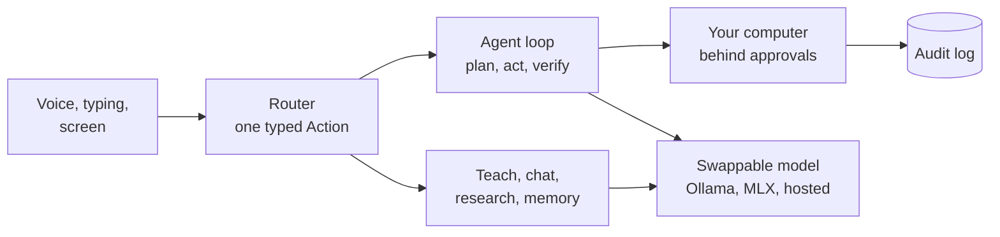

# Sunday

**S.U.N.D.A.Y.** — **S**ees · **U**nderstands · **N**otices · **D**ecides · **A**cts · **Y**ours

> **Can any model go AGI, given the right harness?**

Sunday is an open experiment to find out. It is a local-first agent harness: a voice and screen front end, a memory, a skill library and an action layer wrapped around a swappable model. The bet is that a lot of what looks like "intelligence" comes from the loop around the model (planning, verifying, remembering, learning from failure) and not only from the weights. If that is true, a small local model with a good harness should keep getting more capable, and a bigger model should get further still.

We don't claim to have AGI. We claim a measurable target, and the repo is organised to chase it:

> **v1 bar:** Sunday completes open-ended, multi-day goals on your own machine with no hand-holding, scoring **>= 70% on a fixed 50-task eval suite**, with the pass rate rising week over week while the model stays constant.

If the number moves, the harness is doing real work. If it doesn't, we learn that too. Either way it is a number, not a vibe.

Track progress in the [v1 master issue](https://github.com/rithulkamesh/sunday/issues/31). Docs: [sunday.rithul.dev](https://sunday.rithul.dev).

## How it fits together



Every box is a module with a test; the [architecture page](docs/ARCHITECTURE.md) has the loop, the approval tiers and the data model in detail.

## Where it is today

Honest status. This is early software, macOS only, and runs on a 4B local model by default.

| | |
|---|---|
| **Sees** | Screenshot, local OCR with exact boxes, vision model for diagrams, click-through overlay that points at things |
| **Understands** | Teaches any subject (plans, concepts, quizzes, spaced review), imports your notes |
| **Notices** | Wake word, voice activation, your voiceprint, long-term memory with provenance |
| **Decides** | Every utterance becomes one typed `Action`; a deterministic rules router with a fine-tuned decision model behind the same trait |
| **Acts** | Opens apps, pages and files, types, presses shortcuts, clicks. Checks each step really happened, retries what didn't, and stops honestly. All behind tiered approvals and an audit log |
| **Yours** | Ollama, MLX on this Mac, or a hosted model for chat or planning; SQLite on disk; web access off unless you switch it on |
| **Measured** | An eval suite with a sandbox, routing and agent tasks, and a prompt-injection red team, run on every PR |

What each of these does in detail: [docs/FEATURES.md](docs/FEATURES.md).

## What's next (v1)

1. **Measure**: grow the eval suite to 50 tasks and track the pass rate every night.
2. **Agent loop**: persistent tasks that survive restarts (the loop and verifiers are in review).
3. **Tools**: MCP, a sandboxed shell, a browser driver.
4. **Memory that compounds**: successful runs become reusable skills, gated by the evals.
5. **Self-improvement**: failure analysis and a promotion gate; the router already learns from corrections.
6. **Everywhere**: Windows and Linux.

The full list, with status, is the [roadmap](docs/ROADMAP.md). Everything is a labelled issue: browse [`roadmap`](https://github.com/rithulkamesh/sunday/labels/roadmap).

## Quick start

```sh
scripts/fetch-models.sh     # speech models into ~/.cache/sunday/models
scripts/build-ocr.sh        # screen helper; needs Xcode command line tools
ollama pull qwen3:4b-instruct && ollama pull nomic-embed-text-v2-moe
ollama pull qwen3-vl:4b-instruct   # only for diagrams and non-text screens
bun install && bun run tauri dev
```

Check it with `cd src-tauri && cargo test` (about a second, needs nothing installed) and `bun run test:live` for the tests that need Ollama and the models.

Say "sunday" or hold fn, then talk, or type in the workspace. Full walkthrough and troubleshooting: [docs/GETTING_STARTED.md](docs/GETTING_STARTED.md).

## Docs

- [Getting started](docs/GETTING_STARTED.md): install, first run, things to try, where to begin hacking
- [Architecture](docs/ARCHITECTURE.md): the agent loop, approvals, routing, platform layer and data model, as diagrams
- [Roadmap](docs/ROADMAP.md): what shipped, what is in review, what is next
- [Features](docs/FEATURES.md): what exists and how it behaves
- [Providers](docs/PROVIDERS.md): Ollama, MLX and hosted models, keys and privacy
- [Router](docs/ROUTER.md): how an utterance becomes an action, and how that gets smarter
- [What's in the repo](docs/REPO_MAP.md): every module, the data flow, the database tables
- [Testing](docs/TESTING.md) and [Evals](docs/EVALS.md): hermetic tests, live tests, the eval suite and CI
- [Contributing](CONTRIBUTING.md): the issue-to-PR flow, safety rules, working with AI coding agents

## Help build it

Pointing your own Claude (or any coding agent) at this repo is welcome. Start from issues labelled
[`claude-friendly`](https://github.com/rithulkamesh/sunday/labels/claude-friendly),
[`good first issue`](https://github.com/rithulkamesh/sunday/labels/good%20first%20issue) or
[`help wanted`](https://github.com/rithulkamesh/sunday/labels/help%20wanted). Windows and Linux ports need people on those machines.

## License

GPL-3.0-or-later. Forks and derivatives must stay open source under the same license. See [LICENSE](LICENSE).
