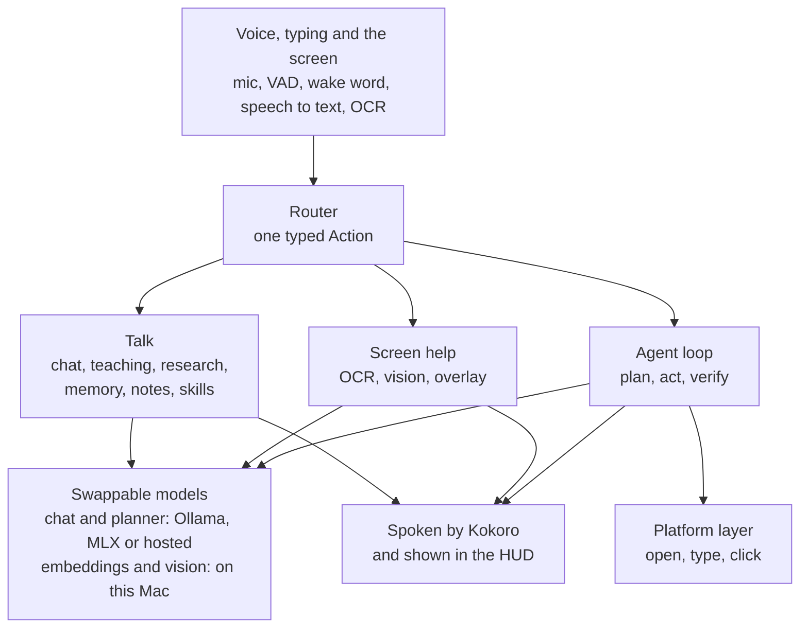
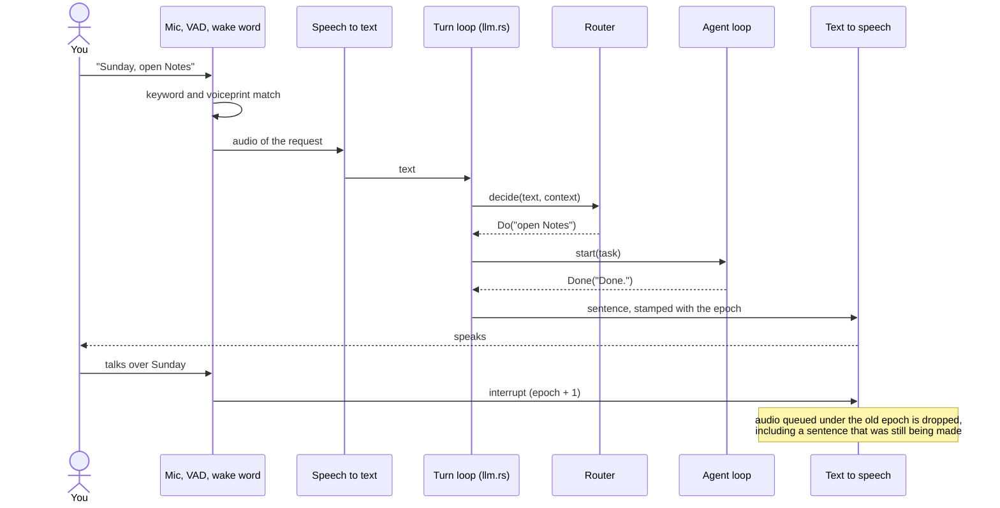
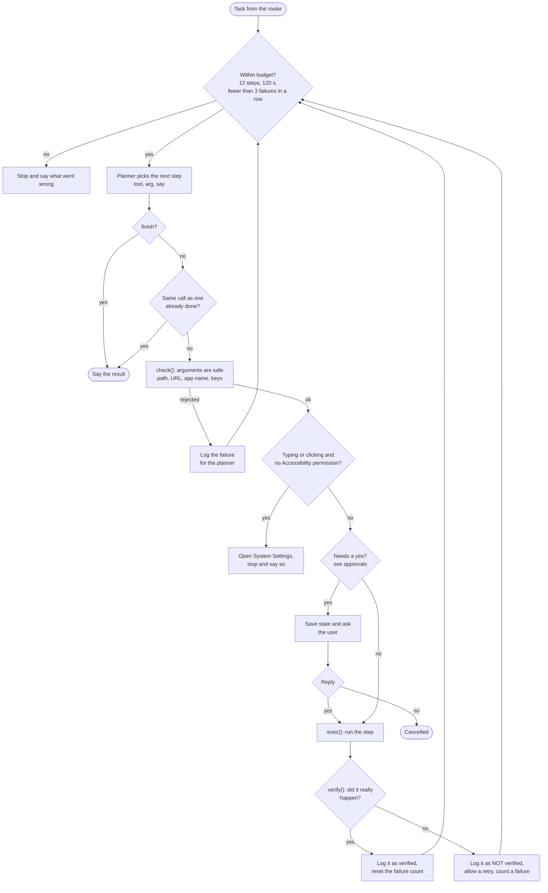
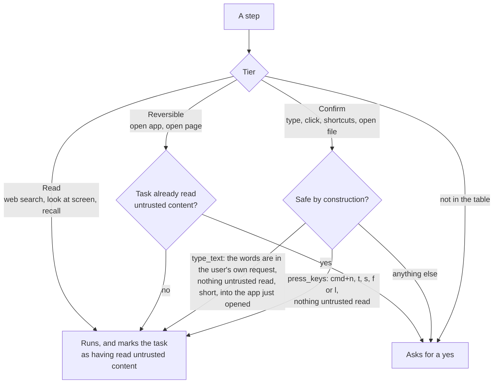
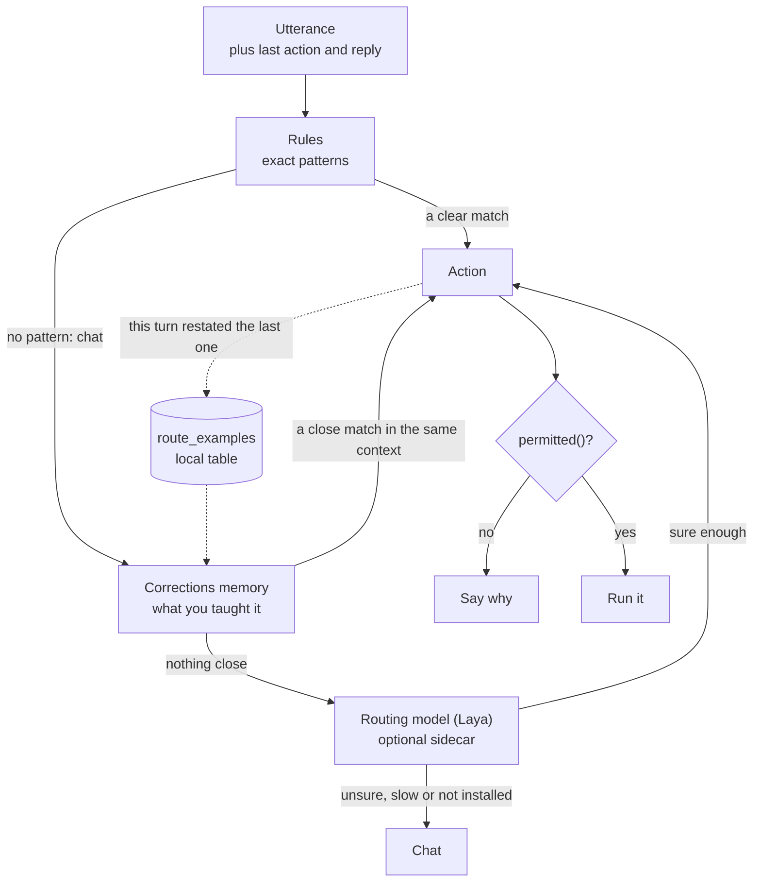
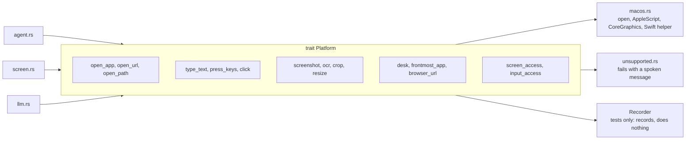
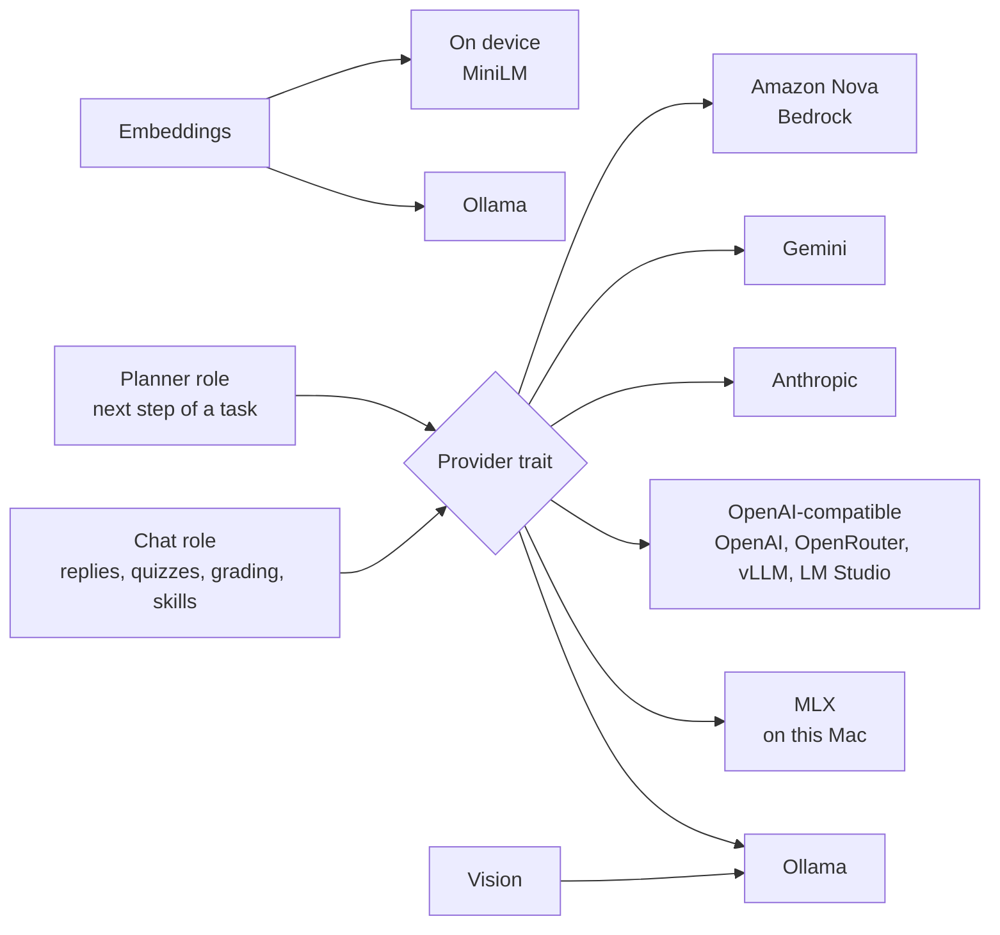
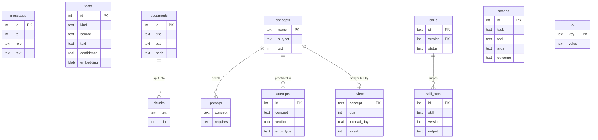
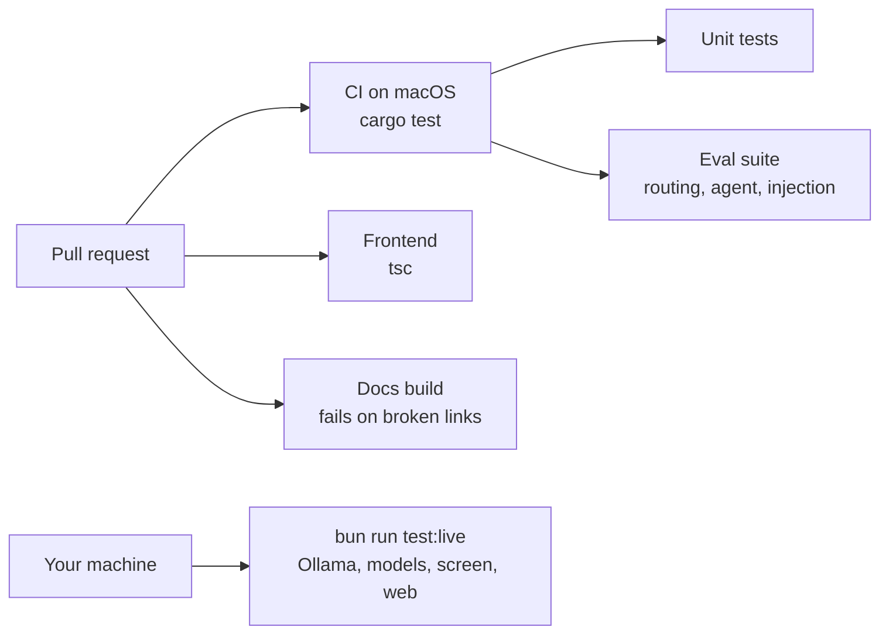

# Architecture

How Sunday fits together, from a sound in the room to a click on the screen. The diagrams are the source of truth for the shape of the system; the [repo map](REPO_MAP.md) says which file each box lives in.

## The whole thing

Everything runs on your machine. The model behind each role is swappable, and the only network calls are to a model you chose and, if you switch web access on, the pages you ask Sunday to read.

Every utterance becomes exactly one `Action` before anything runs. `Rules` is the deterministic router and always the fallback; a smarter router plugs in behind the same `Decider` trait (see [Router](ROUTER.md)).

## A voice turn

What happens between "Sunday, open Notes" and the reply, including the part where you talk over it.

Barge-in works without echo cancellation: while Sunday talks, the mic hears Sunday, so the detector learns the echo level and only fires when you are clearly louder than it and your voice matches yours. Each spoken sentence carries the epoch it was requested under, and an interrupt bumps the epoch, so anything queued earlier is discarded. The check and the queueing happen under the same locks, so an interrupt cannot slip in between them and leave stale audio playing.

## The agent loop

`agent.rs` runs one typed step at a time. The model only ever picks a tool name and one argument; code decides what happens next.

A failed or unverified step is not "done": the planner reads `failed or NOT verified` in the step log and can try again differently. Every log line carries the tool and what it was given (`open_url(https://…) → done (verified)`), so the model can tell what was already done. Three failures in a row end the task with an honest message instead of trying forever, and a missing permission ends it at once because retrying cannot fix it.

### Approvals

Every tool has a tier in one table (`POLICY`). The model can't reach it; it only picks a name.

"Tainted" means the task has read the web, the screen or memory. It is set by code, never by the model, and never cleared, so content that was read can never talk its way into an action that runs without asking. The typing rule compares the text with the user's own request, which the model cannot change.

### Verifiers

After a step runs, `verify()` checks real state instead of trusting that it worked.

| Step | What is checked | If it can't be checked |
|---|---|---|
| `open_app` | the app comes to the front (polled for about 3 s) | |
| `open_url` | the front browser's address bar is on the same host | unverified |
| `open_path` | the path exists | |
| `type_text` | the first 30 letters and digits appear on screen (screenshot and OCR) | unverified |
| `web_search`, `look_at_screen` | the result is not empty | |
| `press_keys`, `click`, `recall` | nothing yet | unverified |

Unverified steps are logged without the `(verified)` mark, so the planner and the audit log can tell the difference.

## Routing

`Rules` never goes away: it decides first, and it is the answer whenever the other two are missing, slow or unsure. The corrections memory and the routing model only choose where an utterance that matched no pattern goes, and `permitted()`, the tiers and the approvals run exactly as before, so a wrong route can waste a turn but cannot widen what Sunday may do. The model needs more confidence to send you to the screen (a screenshot nobody asked for is the costly mistake) than to an action. Details and measurements: [Router](ROUTER.md).

Chat can't claim computer actions either. A chat reply that says it opened, clicked, played or typed something is cut off and replaced with an honest line, because in conversation nothing was done on the computer.

## Platform layer

All OS-specific code lives behind one trait in `src-tauri/src/platform/`. Nothing else may call `osascript`, `screencapture`, `open` and the like.

In tests and evals the `Recorder` stands in, so a test can say "this would have opened Notes" without touching the machine.

## Models and providers

The planner follows chat until you set it separately. Embeddings and vision always run on this Mac, so notes and screenshots are never sent out for indexing. Setup and privacy: [Providers](PROVIDERS.md).

## Memory and data

One SQLite file holds everything.

`actions` is the audit log of everything the agent did, with the tier and whether it ran on its own or you approved it. `kv` holds settings and the saved state of a task waiting for a yes.

## Tests and CI

The default tests need nothing but the code. Anything that needs Ollama, models, the screen or the web is `#[ignore]`d and runs locally. More in [Testing](TESTING.md).
