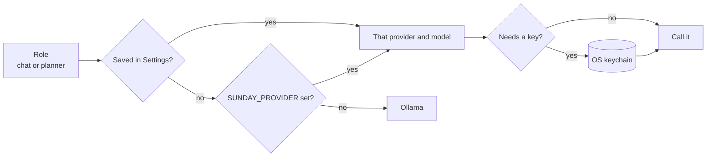

# Providers

A provider is where a model call goes. Sunday runs on **Ollama** by default, so nothing leaves your machine. You can send some roles to a hosted model and keep the rest local.

## Roles

| Role | What it does | Providers |
|---|---|---|
| Chat | Replies, quizzes, grading, skills | any |
| Planner | Picks the next step when Sunday acts on your computer | any, follows Chat until you set it |
| Vision | Reads diagrams and non-text screens | Ollama only |
| Embeddings | Memory and note search | Ollama, or on this Mac (all-MiniLM-L6-v2, no Ollama) |
| Router | Decides what an utterance means | built-in rules, no model; optionally a small on-device decision model ([Router](ROUTER.md)) |

## Set one up

Open **Settings → Models** and press **Change** on Chat or Planner. Choose a provider, paste its key if it needs one, pick a model, then press **Test and use**. Nothing is saved until the test passes, so a wrong key or model shows up there, not mid-sentence. Switching the planner to a hosted model while chat stays on Ollama takes one pass through that form.

**Keys live in your operating system's keychain**, never in the database, the repo or the logs. Sunday doesn't show a saved key again; you can replace or remove it.

Prefer environment variables? They win over saved settings, which is handy for CI and scripts.

| Provider | Key variable | Other settings |
|---|---|---|
| `ollama` | none | runs on `localhost:11434` |
| `mlx` (on this Mac, no Ollama) | none | Apple Silicon only. Model is a Hugging Face id such as `mlx-community/Qwen3-4B-Instruct-2507-4bit`; get it with `scripts/fetch-mlx-model.sh <id>` |
| `lmstudio` (local) | none | `LMSTUDIO_BASE_URL`, default `http://localhost:1234/v1` |
| `openrouter` | `OPENROUTER_API_KEY` | model ids look like `openai/gpt-4o-mini` |
| `openai` (OpenAI, vLLM, llama.cpp server, any OpenAI-compatible URL) | `OPENAI_API_KEY`, optional for local servers | `OPENAI_BASE_URL` |
| `anthropic` | `ANTHROPIC_API_KEY` | |
| `gemini` | `GEMINI_API_KEY` | uses Google's OpenAI-compatible endpoint |
| `nova` (Amazon Nova on Bedrock) | `AWS_BEARER_TOKEN_BEDROCK` | `AWS_REGION`, default `us-east-1`; replies arrive in one piece, not word by word |

`SUNDAY_PROVIDER` and `SUNDAY_MODEL` still pick the provider and model for chat when nothing is saved in Settings.

## LM Studio

Start the local server in LM Studio (Developer tab, default port 1234), load a model, then pick **LM Studio** in **Settings → Models → Change**. The model list comes from the server. Prompts stay on your machine. Use an instruct build, not a thinking one, and one that supports structured output so the planner's JSON schema is honoured. Embeddings and vision still use Ollama or the on-device embedder.

## Run without Ollama (MLX)

On Apple Silicon, Sunday can run the chat and planner models inside the app with [MLX](https://github.com/ml-explore/mlx): no Ollama, no Python, nothing else running. Prompts never leave your Mac.

```sh
scripts/fetch-mlx-model.sh mlx-community/Qwen3-4B-Instruct-2507-4bit
```

Then in **Settings → Models → Change**, pick **MLX (on this Mac)** and the model. The first reply loads the model (a second or two); after that it stays in memory. Qwen2, Qwen3 and Gemma 4 checkpoints work.

Two limits: MLX can't constrain output to a JSON schema, so Sunday puts the schema in the prompt and retries once if the reply isn't valid JSON (small models slip more often than with Ollama); and screen vision still uses Ollama.

For memory search without Ollama, download the on-device embedding model (about 90 MB, English) and choose it under **Embeddings** in the same screen:

```sh
scripts/fetch-embed-model.sh
```

It's tried before it's saved. Facts remembered with the other embedder are found by keyword until they come up again, so nothing is lost by switching.

Building Sunday with MLX needs full Xcode (it ships the Metal compiler). Without it: `cargo build --no-default-features --features voice`.

## Privacy

Anything but Ollama or MLX sends the prompt to that provider. A prompt can include your notes and memories that matched the question, and the text of web pages or the screen when you asked Sunday to look at them. Settings shows a warning next to every role that leaves your machine. Embeddings and vision always run on this Mac, so notes and screenshots are never sent for indexing.

## Cost

Sunday sends short prompts with a few retrieved notes, and the planner makes one call per step, at most 12 steps per task. Hosted prices change, so check your provider's page. The cheapest way to try a hosted model is the planner role alone.

## Test a provider

```sh
SUNDAY_PROVIDER=openai OPENAI_BASE_URL=http://localhost:11434/v1 SUNDAY_PROVIDER_TEST=1 \
  cargo test conformance::live -- --ignored --nocapture
```

This runs a real request and a real stream against the chosen provider. The same checks run in CI for every provider against a local mock server.



## Add a provider

1. Implement `Provider` in `src-tauri/src/provider.rs`: `complete`, `stream`, `models`, `warm`, `name`.
2. Add it to `build` and to the provider list in Settings.
3. Add a mock that answers in its wire format and a test that calls `check`, as the existing providers do.
4. Keep the safety rule: a new provider is opt-in and its calls only happen after the user picks it.
