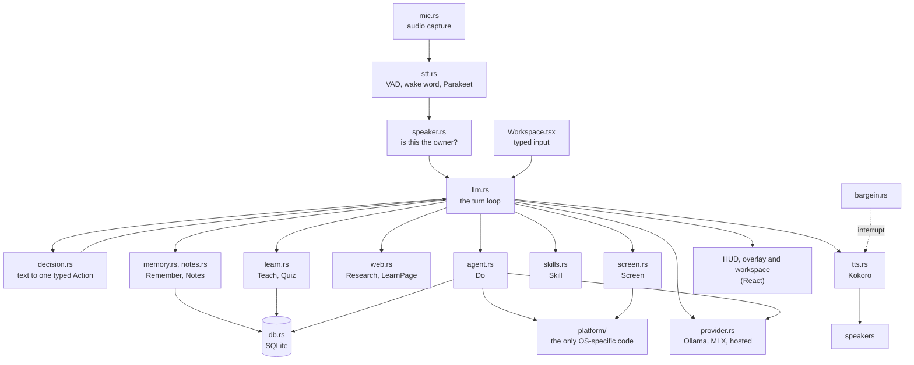
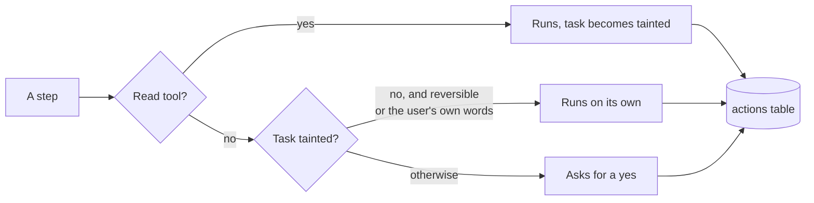

# What's in the repo

Tauri 2 app: a Rust backend (`src-tauri`) and a React 19 + Tailwind 4 frontend (`src`). Everything runs locally; the only network calls are to the model provider you chose (Ollama on `localhost:11434` by default) and, if you switch web access on, the pages you ask it to read.

For how the pieces behave together, read [Architecture](ARCHITECTURE.md). This page says where each one lives.

## Data flow

Every utterance becomes exactly one `Action` before anything runs. The `Decider` trait is the seam for a smarter router; `Rules` is the deterministic default and the fallback.

## Backend (`src-tauri/src`)

| File | What it does |
|---|---|
| `main.rs` | App setup, Tauri commands, hotkeys, and wiring of the audio, speech and model threads |
| `llm.rs` | The turn loop: routes an `Action`, builds the prompt with memory and note context, calls the chosen provider (chat, vision, embeddings, JSON-schema output), runs skills, ends sessions. Chat replies that claim a computer action are replaced with an honest line |
| `provider.rs` | The `Provider` trait and its implementations: Ollama, MLX (in process), OpenAI-compatible, Anthropic, Gemini, Amazon Nova. Per-role settings (chat, planner), keys in the OS keychain, the conformance checks and their mock servers |
| `mlx.rs` | The in-process MLX provider for Apple Silicon (no Ollama) |
| `decision.rs` | `Action` enum, `Decider` trait, `Rules` router, `permitted()` |
| `agent.rs` | Acting on the computer: one typed `Step` at a time, planner prompt and schema, budgets (steps, time, failures), approvals by tier (`POLICY`) with taint, the typing and shortcut exceptions, path/URL safety checks, verifiers after each step, retry on failure, audit log. Tools: web search, look at screen, recall, open app / page / file, type, press keys, click, finish |
| `learn.rs` | Teaching: learning plans, concepts, prerequisites, quizzing, grading, spaced review, and the persona prompt (`IDENTITY`) |
| `memory.rs` | Long-term facts with provenance, confidence and embeddings; recall by meaning |
| `localembed.rs` | On-device embeddings (all-MiniLM-L6-v2 via candle), so memory search works without Ollama |
| `notes.rs` | Import PDF / Markdown / text, chunk and index in SQLite FTS5 |
| `skills.rs` | Versioned prompt-only skills: proposed → experimental → approved, tests, rollback |
| `web.rs` | Safe fetching (public addresses only, redirect re-checks, size caps), Readability extraction, headless Chrome fallback, search |
| `platform/` | Everything OS-specific behind the `Platform` trait: open app/page/file, type, shortcuts, click, screenshot, window list, OCR, browser address, permissions (screen recording, Accessibility). `macos.rs` is the real one; other OSes use `unsupported.rs`, which fails with a spoken message; tests use a recorder |
| `screen.rs` | Screenshot, OCR boxes, window list, vision call, overlay drawing, click preview |
| `stt.rs` | Speech to text (Parakeet via ONNX), wake-word spotting |
| `tts.rs` | Text to speech (Kokoro): the voice and pace, the interrupt epoch, queueing |
| `speaker.rs` | Voiceprint (wespeaker ResNet34), "is this the owner" check |
| `bargein.rs` | Interrupt handling: stop words, talking over Sunday |
| `mic.rs`, `models.rs` | Audio capture, model file locations |
| `db.rs` | SQLite schema and queries |
| `eval.rs` | The eval harness: loads `evals/*.jsonl`, runs routing and agent tasks in the sandbox, reports regressions (a test, so `cargo test` runs it) |

## Frontend (`src`)

| File | View |
|---|---|
| `Workspace.tsx` | Main window: chat and typed input |
| `Hud.tsx` | Floating status HUD |
| `Overlay.tsx` | Click-through drawing layer for boxes, circles, arrows |
| `Palette.tsx` | ⌘K command palette |
| `Knowledge.tsx` | Notes import and search |
| `Memory.tsx` | Browse and delete facts and pages |
| `Skills.tsx` | Draft, test, approve, roll back skills |
| `Providers.tsx` | Providers, keys and the model for each role |
| `Settings.tsx` | Models, web switch, diagnostics |
| `ui.tsx`, `index.css` | Shared components and styles |

## Everything else

| Path | Purpose |
|---|---|
| `evals/` | Eval tasks, one JSON line each: `routing.jsonl`, `agent.jsonl`, `injection.jsonl`. Results land in `evals/runs/`. See [Evals](EVALS.md) |
| `docs/`, `website/` | These docs and the site that serves them (Docusaurus, Mermaid diagrams) |
| `.github/workflows/` | `ci.yml` (tests, frontend types) and `docs.yml` (site build and deploy) |
| `scripts/fetch-models.sh` | Download VAD, wake word, speaker-ID, Parakeet and Kokoro into `~/.cache/sunday/models` |
| `scripts/fetch-mlx-model.sh`, `scripts/fetch-embed-model.sh` | Download an MLX chat model, or the on-device embedding model |
| `scripts/build-ocr.sh`, `scripts/ocr.swift` | macOS Vision OCR helper: exact text line boxes, window list, cropping, the clicker |
| `CLAUDE.md` | The short version of the rules, for coding agents |

## Database (SQLite, one file)

`messages`, `kv`, `concepts`, `prereqs`, `attempts`, `reviews` (learning); `documents` + FTS index (notes); `facts` (memory); `skills`, `skill_runs` (skills); `actions` (audit log of everything the agent did). The relationships are in the [architecture diagram](ARCHITECTURE.md#memory-and-data).

## Safety model today

- Opening apps and pages you asked for just happens. Typing the words you said into the app you just opened, and the shortcuts for new note, save and new tab, also just happen. Everything else that types, clicks or opens a file asks for a yes.
- Once anything read from the web, the screen or memory is in play, every step asks. Read content is data, never a command.
- File access: your home folder only, no hidden folders. Web: http(s) only, public addresses, redirects re-checked.
- After a step runs, the agent checks that it really happened and says so when it can't tell.
- Every step lands in the `actions` table with its tier and whether it ran on its own or you approved it.

The prompt-injection suite ([#11](https://github.com/rithulkamesh/sunday/issues/11)) runs in every `cargo test`.

## Not here yet

A persistent multi-step task that survives restarts, MCP and a tool SDK, a browser driver, a sandboxed shell, Windows and Linux. All on the [roadmap](ROADMAP.md).
