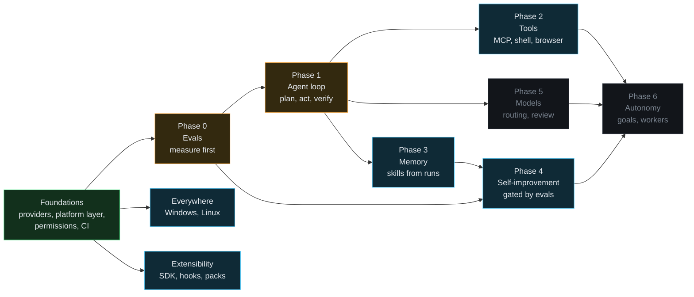

# Roadmap

Sunday's goal is a number, not a vibe:

> **v1 bar:** Sunday completes open-ended, multi-day goals on your own machine with no hand-holding, scoring **>= 70% on a fixed 50-task eval suite**, with the pass rate rising week over week while the model stays constant.

The [v1 master issue](https://github.com/rithulkamesh/sunday/issues/31) is the source of truth and every item below is a labelled GitHub issue. This page is a snapshot (last updated 21 October 2026) so you can see the shape of the work without opening the tracker.

## The shape of it

Work is ordered so that nothing is built that can't be measured first. Measure, then give the agent a loop, then tools, then memory that compounds, then let it improve itself behind the evals.

Green is shipped, amber is partly shipped, blue is next, grey is later.

## Shipped

| What | Issues |
|---|---|
| **Eval harness.** Routing, agent and prompt-injection tasks, run in a sandbox with a fake home folder and a canned web; every task runs twice and must agree; regressions are reported against the previous run | [#1](https://github.com/rithulkamesh/sunday/issues/1), [#3](https://github.com/rithulkamesh/sunday/issues/3), [#11](https://github.com/rithulkamesh/sunday/issues/11) |
| **Tiered permissions.** One policy table (read, reversible, confirm), explicit taint from anything read, tier recorded in the audit log | [#10](https://github.com/rithulkamesh/sunday/issues/10) |
| **Providers.** One trait, then Ollama, MLX (on this Mac, no Ollama), OpenAI-compatible, Anthropic, Gemini and Amazon Nova, a conformance suite and a settings screen with keys in the OS keychain | [#32](https://github.com/rithulkamesh/sunday/issues/32) to [#39](https://github.com/rithulkamesh/sunday/issues/39) |
| **Platform layer.** Every OS call behind one trait, so a port is one file | [#21](https://github.com/rithulkamesh/sunday/issues/21) |
| **CI and docs.** Build and test on macOS, a docs site that fails on broken links, a guide for working with coding agents | [#22](https://github.com/rithulkamesh/sunday/issues/22), [#44](https://github.com/rithulkamesh/sunday/issues/44), [#20](https://github.com/rithulkamesh/sunday/issues/20) |
| **Agent loop and verifiers.** Budgets, a check of real state after every step, retry on failure, an honest stop. Typing your own words and the shortcuts for new note, save and new tab no longer ask | [#5](https://github.com/rithulkamesh/sunday/issues/5), [#6](https://github.com/rithulkamesh/sunday/issues/6), [PR #54](https://github.com/rithulkamesh/sunday/pull/54) |
| **Hermetic tests, faster CI.** Default tests need nothing external; the rest are ignored with a reason and run with `bun run test:live` | [PR #55](https://github.com/rithulkamesh/sunday/pull/55) |
| **A smarter router.** An optional fine-tuned Laya decision model for what `Rules` has no pattern for (98% and 94% on two held-out sets, no conversation sent to an action), and a memory that learns from corrections at once. `Rules` stays the fallback | [Router](ROUTER.md), [PR #57](https://github.com/rithulkamesh/sunday/pull/57), related to [#41](https://github.com/rithulkamesh/sunday/issues/41) |

## Next

### Phase 0: measure

| Issue | What |
|---|---|
| [#2](https://github.com/rithulkamesh/sunday/issues/2) | Seed the 50-task eval suite (the v0.1 benchmark) |
| [#50](https://github.com/rithulkamesh/sunday/issues/50) | Nightly eval run with pass-rate tracking |

### Phase 1: the agent loop

| Issue | What |
|---|---|
| [#4](https://github.com/rithulkamesh/sunday/issues/4) | A persistent task object: goal, plan, state and artifacts that survive restarts |
| [#58](https://github.com/rithulkamesh/sunday/issues/58) | Follow-ups on what is already open: continuity, reusing the tab or window, grounded actions, fewer pointless questions |
| [#5](https://github.com/rithulkamesh/sunday/issues/5), [#6](https://github.com/rithulkamesh/sunday/issues/6) | Plan, act, observe, verify, replan, with verifiers (shipped; still open: a token budget and a planner that returns a whole step list) |

### Phase 2: tools

| Issue | What |
|---|---|
| [#7](https://github.com/rithulkamesh/sunday/issues/7) | MCP client: load external tools as agent actions |
| [#8](https://github.com/rithulkamesh/sunday/issues/8) | Sandboxed shell and code execution |
| [#9](https://github.com/rithulkamesh/sunday/issues/9) | A browser driver for DOM-level actions |

### Phase 3: memory that compounds

| Issue | What |
|---|---|
| [#12](https://github.com/rithulkamesh/sunday/issues/12) | Split memory into episodic, semantic and procedural |
| [#13](https://github.com/rithulkamesh/sunday/issues/13) | Distil successful runs into reusable skills |

### Phase 4: self-improvement, behind the evals

| Issue | What |
|---|---|
| [#14](https://github.com/rithulkamesh/sunday/issues/14) | Failure analysis: a critic reads traces and proposes fixes |
| [#15](https://github.com/rithulkamesh/sunday/issues/15) | A promotion gate: ship only changes that raise the pass rate without regressions |
| [#56](https://github.com/rithulkamesh/sunday/issues/56) | The router learns from corrections: log, retrain, promote only if the held-out eval holds |

## Later

| Issue | What |
|---|---|
| [#16](https://github.com/rithulkamesh/sunday/issues/16), [#17](https://github.com/rithulkamesh/sunday/issues/17) | A model router (small local model for routing, a stronger one for planning) and a reviewer pass on high-stakes steps |
| [#18](https://github.com/rithulkamesh/sunday/issues/18), [#19](https://github.com/rithulkamesh/sunday/issues/19) | Background goals and a scheduler (a proactive Sunday), then planner and worker decomposition once a single agent saturates |

## Everywhere

macOS only today. The platform layer means a port is one file plus the rules for that OS.

| Issue | What |
|---|---|
| [#23](https://github.com/rithulkamesh/sunday/issues/23), [#24](https://github.com/rithulkamesh/sunday/issues/24) | Windows: screen capture and OCR, acting |
| [#25](https://github.com/rithulkamesh/sunday/issues/25), [#26](https://github.com/rithulkamesh/sunday/issues/26) | Linux: screen capture and OCR (X11 and Wayland), acting |
| [#27](https://github.com/rithulkamesh/sunday/issues/27) | Cross-platform speech: audio I/O, wake word, push-to-talk key, TTS |
| [#28](https://github.com/rithulkamesh/sunday/issues/28), [#29](https://github.com/rithulkamesh/sunday/issues/29) | Setup scripts and packaging, and a paths, permissions and safety audit |

## Extensibility

See [Plugins](PLUGINS.md) for the ground rules.

| Issue | What |
|---|---|
| [#40](https://github.com/rithulkamesh/sunday/issues/40) | A tool and plugin SDK for third-party actions |
| [#41](https://github.com/rithulkamesh/sunday/issues/41) | A pluggable decider (router) and planner |
| [#42](https://github.com/rithulkamesh/sunday/issues/42) | Skill packs: share, import and sign, with a community registry |
| [#43](https://github.com/rithulkamesh/sunday/issues/43) | Hooks and an events API: on utterance, on action, on result |

## Help wanted

Issues labelled [`good first issue`](https://github.com/rithulkamesh/sunday/labels/good%20first%20issue), [`claude-friendly`](https://github.com/rithulkamesh/sunday/labels/claude-friendly) and [`help wanted`](https://github.com/rithulkamesh/sunday/labels/help%20wanted) are sized for one PR. The Windows and Linux ports need people on those machines. Start with [Working with agents](AGENTS.md).
