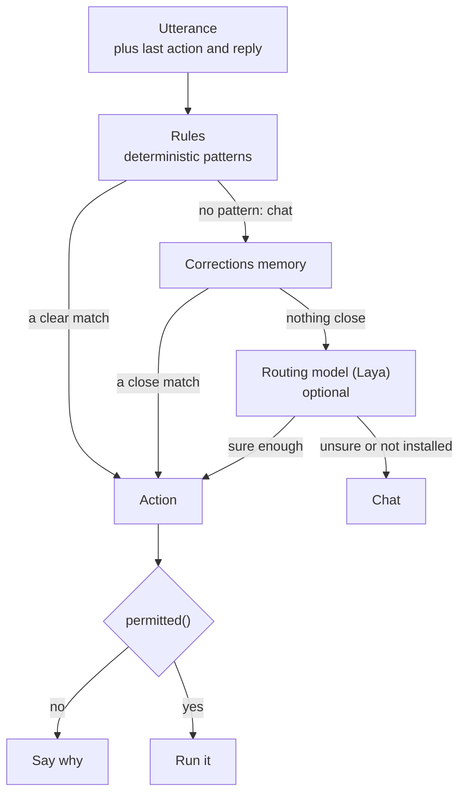

# Router

Every utterance becomes exactly one `Action` before anything runs. This page is how that decision is made, how it gets smarter, and what the smarter part costs.

## Rules

`Rules` (in `decision.rs`) is a list of patterns checked in order (a command that starts with an operating verb wins over a mention of the screen: "sort what is on my screen by the best" acts, "what is on my screen" explains): "learn my voice", "read this page", "research X", "run skill …", "teach me …", a spoken command such as "open …", "show me YouTube videos …", "sort by …" and so on. It ignores fillers and corrections at the start ("uh", "I said", "no,") and the wake word, so they don't hide a command.

It is fast, explainable and always right about what it covers. It cannot use context: "Could you go more in detail?" means one thing after a description of your screen and another after an explanation of a mutex, and `Rules` sees only the words. It also has no way to know that "what's the weather in Paris" needs the web.

## The routing model

When `Rules` has no pattern, Sunday can ask [Laya](https://github.com/NandhaKishorM/laya): a small decision model that answers one typed question about a piece of text in a single forward pass, with calibrated probabilities and no text generation. Sunday gives it the utterance plus the last thing it did and said, and asks which of four routes fits: `chat`, `screen`, `do` or `research`.

The base checkpoint is not good enough on its own. Zero-shot, the best question design got 27 of 48 held-out cases, and the answer swung with option order and wording (12 to 27 of 48 across designs). Laya's own README reports the same pattern, so Sunday fine-tunes it on routing data. The result, on cases it was never trained on:

| Held-out set | Rules alone | Rules + model | Conversations sent to an action |
|---|---|---|---|
| 48 hand-written cases (`evals/router/proto.jsonl`) | 37 right (77%) | **47 right (98%)** | 0 |
| 35 real transcripts, labelled by hand | 25 right (71%) | **33 right (94%)** | 0 |

The same model before fine-tuning scored 56% on the first set. The last column matters most: a wrong route that turns conversation into an action, or into a screenshot nobody asked for, is the costly mistake, so the model must be more confident to choose `screen` (0.90) than `do` (0.80) or `research` (0.85), and there were none.

What it fixes: follow-ups that depend on the last turn ("tell me more" after a screen answer, "sort by the best" after opening YouTube), speech-recognition mishearings, short corrections, and things that need the web. What it still gets wrong in the held-out sets: "Ranked by the best" after opening a results page goes to `research`, and "I think three blue one brown should be good", a reply to its own suggestion, stays chat.

**Read these numbers with care.** The sets are small. The 48 cases were written by the maintainers while looking at where `Rules` failed, and `Rules` has since been improved on them, so its score is flattered too. The real transcripts are dominated by variations of "what's on my screen", and the training data has similar phrasing, so that part is easy by construction; the follow-ups and corrections are the informative cases. Training utterances that match a held-out one are dropped, but near-duplicates are not. Treat this as evidence that the approach works, not as a benchmark of how often it will be right for you.

### What it costs

| | |
|---|---|
| Disk | 1.2 GB model and a 32 MB program |
| Memory | about 1 GB while it runs |
| Time | about 1.2 s to start, about 140 ms per question (only asked when `Rules` has no pattern) |
| Network | none |

It runs as a separate program (`tools/laya-router`) rather than inside the app, because the app already links sherpa-onnx, which embeds its own ONNX Runtime, and two copies in one binary clash. The app starts it in the background at launch and never waits for it: until it is ready, or if it is slow or missing, `Rules` decides alone. `SUNDAY_ROUTER=rules` turns it off.

### Install it

Nothing downloads on its own, and the app works without it. To install the published model, run `scripts/fetch-router.sh` (or `scripts/setup.sh`, which does). It downloads the weights from [Hugging Face](https://huggingface.co/rithulkamesh/sunday-laya-router) at a revision pinned in `scripts/laya/router.sha256`, checks every file's SHA-256, downloads the prebuilt sidecar from the matching GitHub release, and ad-hoc signs it on your machine (`codesign --sign -`, no developer account). Apple silicon only; elsewhere build it yourself. The weights are GPL-3.0-or-later like Sunday, built on Laya (Apache-2.0) and mmBERT (MIT).

To train, export and install your own, follow [scripts/laya/README.md](https://github.com/rithulkamesh/sunday/blob/main/scripts/laya/README.md). In short: generate data, fine-tune (about 3 hours on an M-series Mac), check against the held-out sets, export to ONNX, build the sidecar. When it loads, the log says `[laya] router ready`, then one line per question: `[laya] do 0.96 in 130ms -> do`.

## Corrections teach it, at once

The same turn-by-turn log lets the router learn from you without retraining. When you say outright that you are fixing the turn before ("I said …", "no, …", "I meant …") right after a turn that went to chat ("Ranked by the best." … "I said can you sort by the best?"), the first utterance is stored with the route the second one took, together with an embedding. Only an explicit marker counts: sharing a few words with the last utterance is not enough, because speech recognition garbles things and a garble that happens to share words would teach the wrong route (that happened once in live use, "say it by the best", and is why). Next time something close to it comes up in the same context, that route is used before the model is asked. A new example that contradicts an old one replaces it, so one wrong correction can't stick.

The examples are rows in the local `route_examples` table. There is no screen to list or clear them yet; they are plain SQLite rows. A slower loop that retrains the model on them, and only ships a new checkpoint that passes the held-out sets, is tracked in [#56](https://github.com/rithulkamesh/sunday/issues/56).

## What it can and cannot do

- It only chooses a route. `permitted()`, the tiers, the approvals and the path and URL checks apply to the action it leads to exactly as before, so a wrong route can waste a turn but cannot widen what Sunday is allowed to do.
- `Rules` always decides first, and is always the answer when the model or the memory has nothing to say.
- Nothing is sent anywhere: the model and the memory are local.
- It does not replace the planner. The agent still picks each step; the router only decides that an utterance is a job for the agent.

## Measuring a router

Never judge a learned router on data it was tuned on, or on cases written while looking at its failures. `scripts/laya/eval.py` scores a checkpoint on the held-out sets, with and without the confidence gate the app uses, and `cargo test router_end_to_end -- --ignored --nocapture` runs the real path (`Rules`, then the installed model) on them. `cargo test rules_baseline -- --nocapture` prints what `Rules` alone does, and fails if `Rules` ever turns a conversation into an action. See [Testing](TESTING.md#what-to-add-with-a-change).
