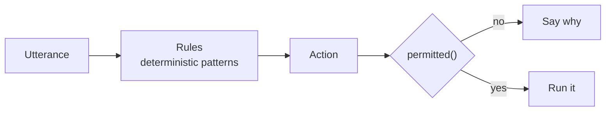

# Router

Every utterance becomes exactly one `Action` before anything runs. This page is how that decision is made and how it is meant to get smarter.

## Rules

`Rules` (in `decision.rs`) is a list of patterns checked in order: "learn my voice", "read this page", "research X", "run skill …", "teach me …", a spoken command such as "open …", "show me YouTube videos …", "sort by …" and so on. It ignores fillers and corrections at the start ("uh", "I said", "no,") and the wake word, so they don't hide a command.

It is fast, explainable and always right about what it covers. It cannot use context: "Could you go more in detail?" means one thing after a description of your screen and another after an explanation of a mutex, and `Rules` sees only the words.

## A smarter router

`Decider` is the trait a smarter router implements. It gets the utterance and whether a question is pending and returns an `Action`; `Rules` stays as the fallback. A smarter router only chooses *where* an utterance goes. `permitted()`, the tiers, the approvals and the path and URL checks apply to the resulting action exactly as before, so a wrong route can waste a turn but cannot widen what Sunday is allowed to do.

### Laya

[Laya](https://github.com/NandhaKishorM/laya) is a decision engine that answers typed questions (`choice`, `score`, yes/no) about a piece of text in a single forward pass of a small encoder, about 100 to 300 ms on this Mac, with calibrated probabilities and no text generation. That is a good fit for "which of these four routes is this?".

The base checkpoint is not good enough on its own. Measured on 48 hand-labelled utterances, including the follow-ups that fail with `Rules`:

| Zero-shot question design | Correct |
|---|---|
| One multiple-choice question (chat, screen, do, research) | 27 of 48 |
| Separate yes/no questions, best threshold | 27 of 48 |
| Example phrases inside each option | 22 of 48 |
| Terse option labels, other option orders | 12 to 19 of 48 |

It does well on clear cases and poorly on conversation, and the answer depends on option order. Laya's own README reports the same pattern (0.36 zero-shot, 0.77 after fine-tuning on a domain's decisions), so the plan is to fine-tune it on Sunday's own routing data rather than ship the base model.

### Corrections teach it

The same log that records what was routed where records what happened next. When you say "I said …", repeat a request, or answer "no" to an approval, that is a label. The plan, tracked in [#56](https://github.com/rithulkamesh/sunday/issues/56), has two speeds: an exemplar memory over those corrections that takes effect on the next turn, and a retrain that ships only if it passes the held-out eval.

## Measuring a router

Never judge a learned router on data it was tuned on, or on cases written while looking at its failures. The held-out sets are kept out of training by construction (any training utterance that matches one is dropped), and one of them is your own real transcripts, labelled by hand. See [Testing](TESTING.md#what-to-add-with-a-change).
