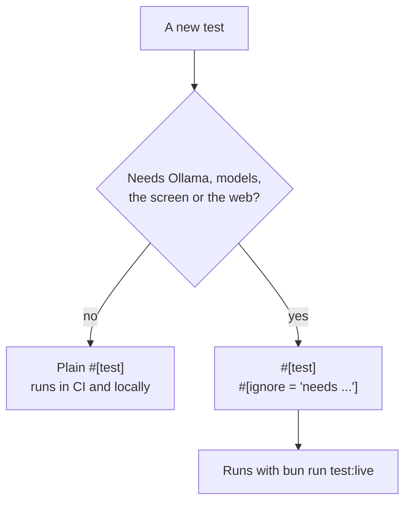
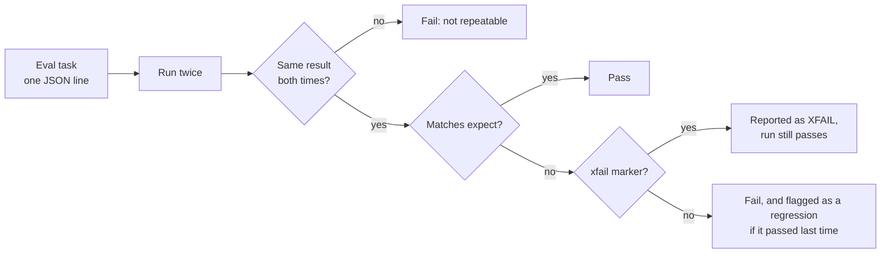
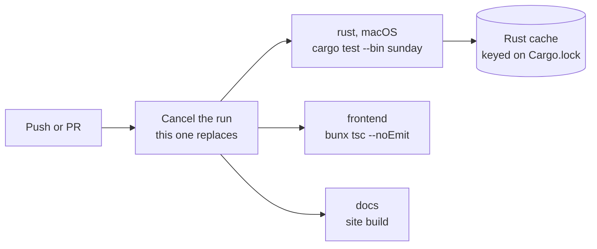

# Testing

Two commands, and CI runs the first one.

```sh
cd src-tauri && cargo test      # hermetic: no Ollama, models, screen or network. About a second
bun run test:live               # the ignored tests that do need them
```

## Hermetic by default

A plain `cargo test` must pass on a machine with nothing installed: no Ollama, no speech models, no screen permission, no internet. That is what CI runs, so a new test is picked up without editing the workflow.

A test that needs any of those things is marked `#[ignore]` with a reason, never an early `return`:

```rust
#[test]
#[ignore = "needs Ollama with the models from scripts/fetch-models.sh"]
fn builtin_skills_pass_their_tests() { /* ... */ }
```

An early `return` when an environment variable is missing reports a pass without testing anything, which is worse than not having the test. An ignored test is listed as ignored, with its reason, every time.



The ignored tests include the live-model checks (skills, plans, the planner choosing the right tool and argument for "open notes and type hello"), speech and wake-word tests, the real screen, real web pages, a real hosted provider, and an audition test that plays the voice out loud.

### Checking a test really is hermetic

Run the default suite with Ollama and the public web blocked and an empty home folder:

```sh
cd src-tauri
BIN=$(cargo test --bin sunday --no-run 2>&1 | grep -o 'target/debug/deps/sunday-[a-z0-9]*' | head -1)
HOME=$(mktemp -d) sandbox-exec -p '(version 1)(allow default)(deny network-outbound (remote ip "*:11434"))(deny network-outbound (remote ip "*:443") (remote ip "*:80"))' ./$BIN
```

Loopback stays open on purpose: the provider conformance tests talk to a mock server on a random local port.

## Evals

`bun run eval` runs the [eval suite](EVALS.md): routing tasks, agent tasks and prompt-injection tasks, all deterministic. It is part of `cargo test` too. The agent tasks run the real loop in a sandbox with a fake home folder and a canned web, with the `Recorder` platform standing in for the OS, so "this would have opened Notes" is an assertion and nothing real happens.



## What to add with a change

| You changed | Add |
|---|---|
| Routing in `decision.rs` | a line in `evals/routing.jsonl` and a case in the `routes_utterances` test |
| An agent tool, a check or a tier | a row in `POLICY` (a test fails without it), a unit test, and an agent eval task |
| A way the agent could be fooled | an injection task; if it gets through, add it with `"xfail"` and a link to the issue |
| Anything that talks to a model | a provider conformance case against the mock server, plus an ignored live test |
| Platform code | nothing outside `src-tauri/src/platform/`; test through the `Recorder` |

Hold-out discipline for anything learned (a trained router, a prompt tuned on examples): the cases you measure on must not be in the data you tuned on, and tuning must never be judged on cases you wrote while looking at its failures. See [Router](ROUTER.md) for how that is handled there.

## CI



- A **warm** run takes one to two minutes: the tests themselves take about a second, the rest is restoring the cache and linking.
- A **cold** run, after a change to `Cargo.lock` or a cache key bump, takes about 13 minutes, most of it building the MLX and speech libraries. `cache-on-failure` keeps that build even if a test fails, so a retry is fast.
- CI has a 30 minute timeout and cancels a run when a newer push replaces it.
- Debug info is off in CI (`CARGO_PROFILE_DEV_DEBUG=0`): smaller objects, faster links, a smaller cache.

## Building while the app runs

Don't run `cargo` in `src-tauri` while `bun run tauri dev` is rebuilding in the same `target/` directory: mixed objects from two compiler sessions can fail to link with missing `_anon.*` symbols. Stop the dev server first, or build somewhere else with `CARGO_TARGET_DIR`. On a Mac with APFS, `cp -cR src-tauri/target /some/other/dir` is an instant copy-on-write clone that keeps the warm cache.
