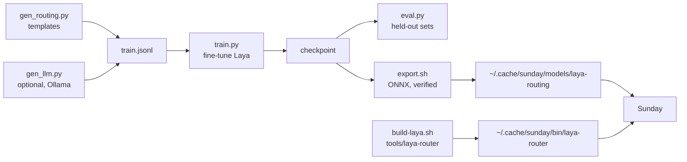

# Routing model (Laya)

Scripts that build, train, check and install the small decision model Sunday can use to route an utterance by meaning. How it fits in: [docs/ROUTER.md](../../docs/ROUTER.md). Nothing here runs unless you run it, and the app works without it.



## One-time setup

A Python 3.12 environment with PyTorch (the training and the ONNX export need it; the app does not), and a clone of Laya at the revision the sidecar is built against:

```sh
uv venv --python 3.12 .venv-laya && source .venv-laya/bin/activate
git clone https://github.com/NandhaKishorM/laya.git ../laya && git -C ../laya checkout ffc1420
uv pip install "torch>=2.9" onnx onnxscript onnxruntime transformers safetensors huggingface_hub numpy -e ../laya
export LAYA_REPO=$PWD/../laya
```

## Build the data, train, check

```sh
cd scripts/laya
python gen_llm.py laya-work             # optional and slow: natural utterances from a local Ollama model
python gen_routing.py laya-work          # about 2,400 template rows, plus the above if present
python train.py laya-work 5              # Apple silicon (MPS); 415 optimizer updates over 5 epochs
python eval.py laya-work/model laya-work # accuracy on the held-out sets; "base" scores the untouched model
```

`gen_llm.py` asks a local Ollama model for natural utterances per route (slow, and the labels come from the prompt plus a keyword filter, so skim `laya-work/llm_rows.jsonl`).

### Held-out sets

| File | What | In git |
|---|---|---|
| `evals/router/proto.jsonl` | 48 hand-written cases, including the follow-ups that `Rules` can't route | yes |
| `evals/router/real.jsonl` | your own transcripts, labelled by hand: one JSON object per line, `{"last": null, "reply": "", "text": "...", "label": "chat"}` | **no** (git-ignored: they are your words) |

`last` is the last thing the assistant did (`chat`, `screen`, `do`, `research` or `null`) and `reply` what it said. Any training utterance that matches a held-out one is dropped, and tuning must never be judged on cases written while looking at a model's failures.

## Install

```sh
scripts/laya/export.sh scripts/laya/laya-work/model    # ONNX, verified against PyTorch, into the models dir
scripts/build-laya.sh                                  # builds tools/laya-router and installs it
```

Then run Sunday. The log says `[laya] router ready` when it loaded, and `[laya] do 0.96 in 120ms -> do` for each utterance the model was asked about. `SUNDAY_ROUTER=rules` turns it off.

The sidecar is a separate program because the app already links sherpa-onnx, which embeds its own ONNX Runtime, and two copies in one binary clash.
